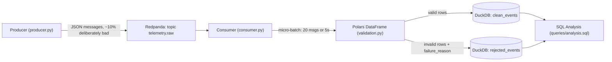

# Real-Time Telemetry Streaming & Quality Analytics

A real-time data pipeline that generates simulated IoT telemetry, streams it through Redpanda, validates it in micro-batches using Polars, and stores clean vs. rejected records separately in DuckDB for analysis.

## Architecture



## How One Event Moves Through the System

A simulated sensor reading is created by the producer as a JSON message and sent to Redpanda's `telemetry.raw` topic. A message broker is used here instead of writing directly to a database because it decouples the producer and consumer in time. If the producer wrote directly to DuckDB and the writing process went down, any messages sent during that downtime would be lost. With Redpanda in between, messages wait in the topic until the consumer is ready, and the consumer resumes from exactly where it left off after a restart. This was verified during development by killing and restarting the consumer mid-stream.

The consumer reads messages and groups them into a micro-batch once it hits 20 messages or 5 seconds have passed, whichever comes first. This keeps processing efficient, since Polars is built for batch operations rather than row-by-row work, and the time trigger stops data from sitting unflushed during a quiet period.

Each batch becomes a Polars DataFrame. Validation checks device IDs for null/empty values, temperature for null/non-finite/out-of-range values (-20C to 60C), humidity for the same (0-100%), and CPU usage for the same (0-100%). Rows are tagged with `is_valid` and, for failures, a `failure_reason` string listing every rule that failed, not just the first one.

Valid rows go to `clean_events`, invalid rows go to `rejected_events` along with their failure reason. The consumer only commits a batch's Kafka offsets after both tables are written, never before. If the ordering were reversed and the program crashed mid-write, a message could be marked "done" without ever being saved, and the data would be lost silently. By committing last, a crash just means the batch gets reprocessed on restart instead of lost.

## Stack

- Python: orchestration
- Redpanda: Kafka-compatible message broker (via Docker)
- Polars: batch validation and transformation
- DuckDB: embedded analytical storage
- Docker Compose: runs Redpanda and its Console UI

## Setup

### Prerequisites
- Docker Desktop
- Python 3.12

### 1. Start Redpanda
```powershell
docker compose up -d
```
Redpanda Console is available at `http://localhost:8080`.

### 2. Create the topic
In Redpanda Console, go to Topics, click Create topic, and name it `telemetry.raw`.

### 3. Set up the Python environment
```powershell
py -3.12 -m venv venv
.\venv\Scripts\Activate.ps1
pip install -r requirements.txt
```

### 4. Run the pipeline
In one terminal:
```powershell
python producer.py
```
In a second terminal:
```powershell
python consumer.py
```

### 5. Query the results
Open `telemetry.duckdb` with any DuckDB client and run the queries in `queries/analysis.sql`.

## Data Quality Rules

| Field | Checks |
|---|---|
| device_id | not null, not empty or whitespace-only |
| temperature | not null, finite, between -20C and 60C |
| humidity | not null, finite, between 0% and 100% |
| cpu_usage | not null, finite, between 0% and 100% |

Each row carries every failing reason it triggered, not just the first, for example `"Null device_id;Empty device_id;"`.

## Design Decisions

- Manual offset commits, applied after the DuckDB write, for at-least-once delivery with no silent data loss on crash.
- Micro-batching by size or time, matching Polars' batch-oriented design while the time trigger prevents data from being stuck in memory during low traffic.
- DuckDB instead of a server-based database, since it's embedded, needs no setup, and reads Polars DataFrames directly with no conversion step.
- Explicit schema on DataFrame creation, to avoid type-inference bugs where an all-null column in one batch gets a different inferred type than in another.

## Next Steps

- Containerize the producer and consumer alongside Redpanda for one-command startup
- Rolling anomaly detection (z-score or IQR per device)
- Windowed aggregates (1-minute or 5-minute rollups)
- A lightweight dashboard (Streamlit) reading live from DuckDB
- Automated tests for the validation logic (pytest)

## Project Structure

```
telemetry-pipeline/
├── producer.py          generates simulated telemetry, sends to Redpanda
├── consumer.py          batches, validates, writes to DuckDB
├── validation.py        Polars validation rules and clean/reject split
├── storage.py            DuckDB connection and table writes
├── docker-compose.yml   Redpanda + Console
├── queries/analysis.sql example SQL queries
└── requirements.txt
```
```