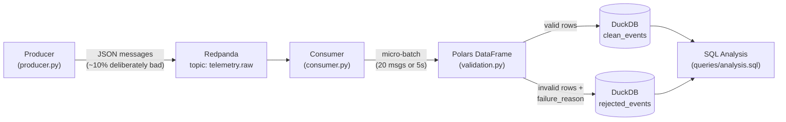

# Real-Time Telemetry Streaming & Quality Analytics

A real-time data pipeline that generates simulated IoT telemetry, streams it through Redpanda, validates it in micro-batches using Polars, and stores clean vs. rejected records separately in DuckDB for analysis.

## Architecture



## How One Event Moves Through the System

A simulated sensor reading is created by the producer as a JSON message and sent to Redpanda's `telemetry.raw` topic. A message broker is used here instead of writing directly to a database because it decouples the producer and consumer in time: if the producer had written directly to DuckDB and the writing process went down, any messages sent during that downtime would be lost forever. With Redpanda in between, messages simply wait in the topic — nothing is lost, and the consumer resumes from exactly where it left off once it's back up (verified manually during development by killing and restarting the consumer mid-stream).

The consumer reads messages and groups them into a micro-batch once it hits 20 messages or 5 seconds have passed, whichever comes first — this keeps throughput efficient (Polars is built for batch, not row-by-row, processing) while guaranteeing data never sits unflushed indefinitely during a quiet period.

Each batch becomes a Polars DataFrame, where validation rules check: device IDs for null/empty values, temperature for null/non-finite/out-of-range values (-20°C to 60°C), humidity for the same (0-100%), and CPU usage for the same (0-100%). Rows are tagged with `is_valid` and, for failures, a `failure_reason` string listing every rule that failed — not just the first one.

Valid rows go to `clean_events`; invalid rows go to `rejected_events` along with their failure reason. Only **after** both tables are successfully written does the consumer commit the batch's Kafka offsets — never before. This ordering is deliberate: if the program crashed between receiving a message and finishing its write, an offset committed too early would mean that message is marked "done" even though it was never actually saved, silently losing data. By committing last, a crash simply means the batch is reprocessed on restart rather than lost.

## Stack

- **Python** — orchestration
- **Redpanda** — Kafka-compatible message broker (via Docker)
- **Polars** — batch validation and transformation
- **DuckDB** — embedded analytical storage
- **Docker Compose** — runs Redpanda + its Console UI

## Setup

### Prerequisites
- Docker Desktop
- Python 3.12

### 1. Start Redpanda
```powershell
docker compose up -d
```
Redpanda Console will be available at `http://localhost:8080`.

### 2. Create the topic
In Redpanda Console → Topics → Create topic → name it `telemetry.raw`.

### 3. Set up the Python environment
```powershell
py -3.12 -m venv venv
.\venv\Scripts\Activate.ps1
pip install -r requirements.txt
```

### 4. Run the pipeline
In one terminal:
```powershell
python producer.py
```
In a second terminal:
```powershell
python consumer.py
```

### 5. Query the results
```powershell
python -c "import duckdb; con = duckdb.connect('telemetry.duckdb'); print(con.execute(open('queries/analysis.sql').read().split(';')[1]).fetchall())"
```
Or open `telemetry.duckdb` with any DuckDB client and run the queries in `queries/analysis.sql`.

## Data Quality Rules

| Field | Checks |
|---|---|
| `device_id` | not null, not empty/whitespace-only |
| `temperature` | not null, finite, between -20°C and 60°C |
| `humidity` | not null, finite, between 0% and 100% |
| `cpu_usage` | not null, finite, between 0% and 100% |

Each row carries every failing reason it triggered, not just the first — e.g. `"Null device_id;Empty device_id;"`.

## Design Decisions

- **Manual offset commits, committed after the DuckDB write** — guarantees at-least-once delivery with no silent data loss on crash (see walkthrough above).
- **Micro-batching (size or time triggered)** — matches Polars' columnar, batch-oriented design, while the time trigger prevents data from being stranded in memory during low-traffic periods.
- **DuckDB over a traditional server-based database** — embedded, zero-setup, and reads Polars DataFrames directly with no conversion step, ideal for a single-writer analytical workload like this.
- **Explicit schema on DataFrame creation** — avoids silent type-inference bugs (e.g. an all-null column in one batch getting a different inferred type than in another).

## Next Steps / Future Improvements

- Containerize the producer and consumer alongside Redpanda for true one-command startup
- Rolling anomaly detection (z-score / IQR per device)
- Windowed aggregates (1-min / 5-min rollups)
- A lightweight dashboard (Streamlit) reading live from DuckDB
- Automated tests for the validation logic (pytest)

## Project Structure

```
telemetry-pipeline/
├── producer.py          # generates simulated telemetry, sends to Redpanda
├── consumer.py           # batches, validates, writes to DuckDB
├── validation.py         # Polars validation rules + clean/reject split
├── storage.py             # DuckDB connection + table writes
├── docker-compose.yml  # Redpanda + Console
├── queries/analysis.sql # example SQL queries
└── requirements.txt
```